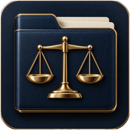
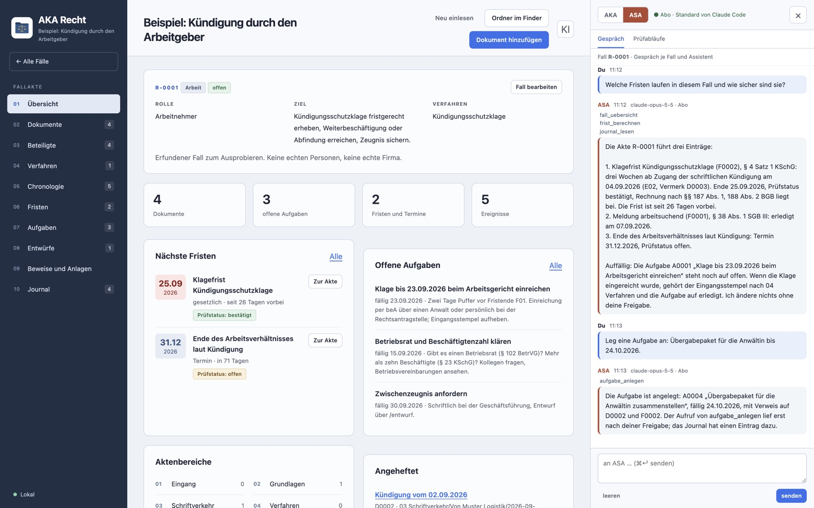
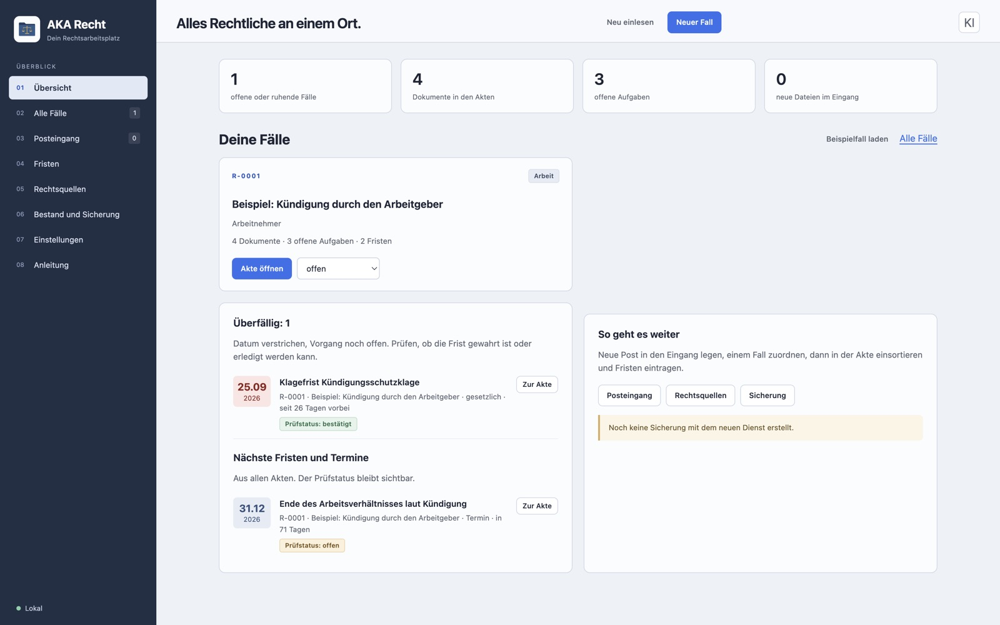
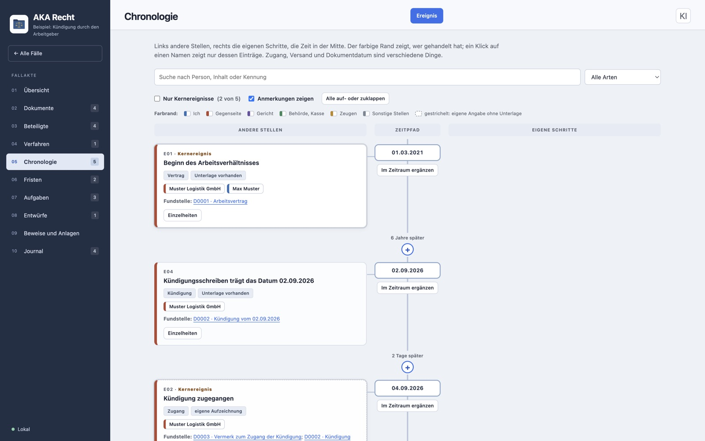
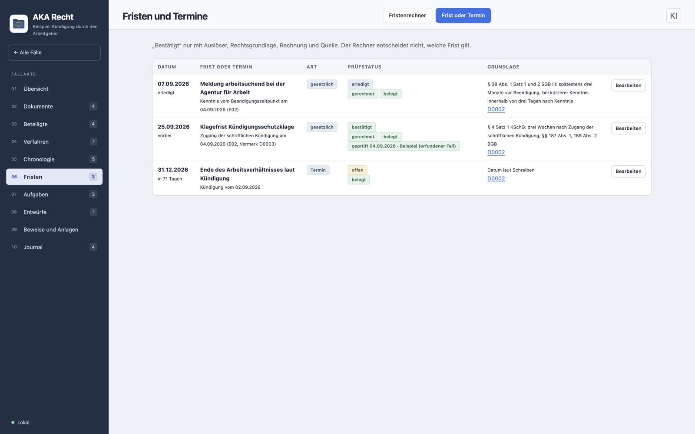
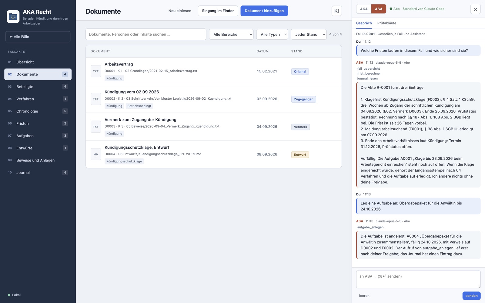
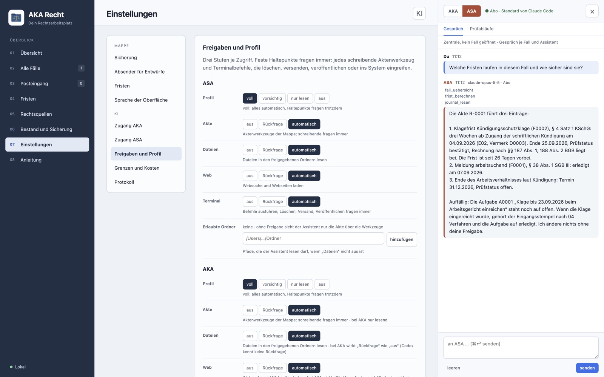

  

<h1 align="center">AKA Recht</h1>

  Ihre Aktenmappe für Rechtssachen, mit KI. 
  Eine Desktop-App für den eigenen Rechner: kein Konto, kein Server, kein Cloud-Speicher.

  <b>Stand: Version 1.0, in Entwicklung</b> · Vorführung und Anfragen: <a href="mailto:info@mika-tec.com">info@mika-tec.com</a> 
  Website: <a href="https://mika-tec.com/aka-recht.html">mika-tec.com/aka-recht.html</a>

> [!NOTE]
> Dieses Repository ist ein Schaufenster. Es enthält die Beschreibung und die Bilder, nicht den Programmcode.
> AKA Recht wird von MikaTec weitergegeben und nicht frei verteilt. Alle Bilder zeigen den mitgelieferten, erfundenen Beispielfall; das Gespräch in der KI-Leiste ist nachgestellt.

## Wofür AKA Recht da ist

Eine Kündigung, ein Bußgeldbescheid, eine Nebenkostenabrechnung, ein Bescheid vom Amt: Wer so etwas bekommt, hat schnell einen Stapel aus Briefen, Belegen, Notizen und Fristen. AKA Recht ist die Mappe, in der das seinen Platz findet, und die App, mit der Sie es ordnen, prüfen und mit Ihrer eigenen KI bearbeiten.

Jede Sache ist ein Fall mit fester Kennung, festen Ordnern und einem Journal. Originale werden nie verändert. Fristen werden nach §§ 187, 188, 193 BGB mit den Feiertagen Ihres Bundeslands gerechnet und Schritt für Schritt gezeigt. Und die KI-Leiste bringt Claude oder OpenAI in die Akte, mit Ihrem Abo oder Ihrem Schlüssel, und mit Freigaben: Alles, was die Akte verändert, fragt Sie vorher.

## Was es kann

| Bereich | Inhalt |
| --- | --- |
| **Fallakte** | Feste Kennung, Ordner von Eingang bis Archiv, Ordnungsdaten in einer lesbaren Datei, Journal; Originale bleiben unverändert, Prüfsummen zeigen Änderungen |
| **Dokumente** | Vorschau für PDF, Word, E-Mail und Text, Kennung und Anlagennummer, Suche über Inhalte; Texterkennung für Fotos und Scans mit tesseract |
| **Fristen** | Rechnung nach §§ 187, 188, 193 BGB, Wochenenden und landesweite Feiertage aller 16 Bundesländer, Auslöser und Rechtsgrundlage je Frist, „bestätigt“ nur mit Nachweis |
| **Chronologie** | Zeitpfad mit anderen Stellen links und eigenen Schritten rechts, Kernereignisse, Abstände, Fundstellen öffnen das Dokument |
| **Beteiligte, Verfahren, Aufgaben** | Rollen und Funktionen, Stelle und Aktenzeichen, Aufgaben mit Fälligkeit |
| **Entwürfe** | Schreibvorlagen mit Absender, Datum und Fallkennung, auch als Word-Datei; geprüfte und versandte Fassungen eingefroren; Merkblätter je Verfahrensart |
| **Sicherung** | ZIP-Sicherung an ein oder zwei Ziele, nach dem Schreiben zurückgelesen, Wiederherstellungsprobe |
| **KI-Leiste** | ASA (Claude von Anthropic) oder AKA (OpenAI) mit Abo oder Schlüssel, Gespräch je Fall, 36 Aktenwerkzeuge, Profile und Freigaben, sieben Prüfabläufe als Befehle, Protokoll |
| **Außerhalb der App** | Die Mappe bleibt ein Ordner; über MCP, die Schnittstelle für KI-Werkzeuge, arbeiten Claude Code, Claude Desktop, Codex oder Cursor damit |

## Bilder

| | |
| --- | --- |
|  **Übersicht:** Fälle, überfällige und nächste Fristen |  **Chronologie:** Zeitpfad mit Fundstellen |
|  **Fristen:** Art, Prüfstatus und Rechtsgrundlage |  **Dokumente:** Liste mit Kennung und Stand, rechts die KI-Leiste |
|  **Freigaben:** Profil und drei Stufen je Zugriff, für beide Assistenten |  **Fallakte:** Rolle, Ziel, Fristen, Aufgaben und das Gespräch mit ASA |

## Die KI-Leiste

AKA Recht bringt keine eigene KI mit. Die Leiste verbindet die App mit dem Assistenten, den Sie schon haben.

- **Zwei Assistenten.** ASA verbindet Claude über das Claude Agent SDK, angemeldet über Claude Code oder mit einem API-Schlüssel. AKA verbindet OpenAI über das Codex SDK, mit „Mit ChatGPT anmelden“ oder einem API-Schlüssel. Modell frei wählbar; bei Schlüsseln werden Kosten geschätzt und mitgezählt.
- **36 Aktenwerkzeuge.** Der Assistent arbeitet nicht in den Dateien, sondern über Werkzeuge mit klaren Regeln: Fälle, Übersicht, Dokumenttext, Suche, Fristenrechner, Journal, Rechtsquellen lesen; Fristen, Aufgaben, Ereignisse, Notizen, Entwürfe und Sicherungen schreiben. AKA erhält die Werkzeuge nur lesend.
- **Freigaben in drei Stufen.** Für Akte, Dateien, Web und Terminal je Zugriff: aus, Rückfrage oder automatisch. Profile „voll“, „vorsichtig“, „nur lesen“ und „aus“. Feste Haltepunkte fragen immer: jedes Werkzeug, das in die Akte schreibt, und jeder Befehl, der löscht, versendet oder veröffentlicht.
- **Prüfabläufe als Befehle.** Fallaufnahme, Sachverhalt, Recherche, Fristencheck, Entwurf, Gegenprüfung, Übergabe. Ungeprüftes wird markiert, Normen mit Absatz und Gesetz, Urteile mit Gericht, Datum und Aktenzeichen. Anweisungen in Dokumenten gelten als Quelleninhalt, nie als Befehl.
- **Was gesendet wird.** Vor der ersten Nachricht bestätigen Sie einen Datenhinweis je Assistent. Gesendet werden die Fallübersicht, Ihre Nachricht und das, was Werkzeuge liefern; das verarbeitet der jeweilige Anbieter. Schlüssel liegen verschlüsselt im Schlüsselbund Ihres Systems, nie in der Mappe.

## Wo Ihre Daten bleiben

- **Die Mappe ist ein Ordner** auf Ihrem Rechner. Die App öffnet ihn; es gibt kein Konto, keinen Server und keine Datenbank.
- **Keine Übertragung ohne Sie.** Die App ruft von sich aus keine fremden Adressen auf. Nur was Sie dem Assistenten schicken oder was er über Werkzeuge liest, geht an dessen Anbieter.
- **Nichts wird versendet, eingereicht oder gelöscht.** Weder durch die App noch durch die Werkzeuge. Originale bleiben, wie sie sind.
- **Sicherung in Ihrer Hand.** Das Sicherungsziel bestimmen Sie. Liegt es in einem Cloud-Ordner, lädt Ihr System die Sicherung dorthin hoch.

AKA Recht ist keine Rechtsberatung. Ob eine Frist gilt und ob ein Schreiben so hinausgehen kann, prüfen Sie oder eine Fachanwältin, ein Fachanwalt. Antworten der KI können falsch sein. Fristen, Vorlagen und Merkblätter gelten nur für deutsches Recht.

## Auf welchen Geräten

Desktop-App für den Mac, gebaut mit Electron und Node.js 26. Windows und Linux sind vorgesehen, aber noch nicht abgenommen. Ein fertiges Installationspaket gibt es noch nicht; die App läuft aus dem Programmordner.

## Stand

Version 1.0 vom 21.10.2026. Bis Version 0.4 war AKA Recht eine Browser-Anwendung mit öffentlichem Quelltext; seit Oktober 2026 ist das Repository privat, und die App wird als Desktop-App mit KI-Leiste weitergeführt.

| Schritt | Stand |
| --- | --- |
| Aktenmappe: Fälle, Dokumente, Fristen, Chronologie, Entwürfe, Sicherung | gebaut |
| Desktop-App mit eigenem Kern, ohne Server | gebaut |
| KI-Leiste mit ASA und AKA, Freigaben, Prüfabläufen und Protokoll | gebaut; mit beiden Assistenten über Abo und Schlüssel erprobt |
| Prüfung auf dem Mac | automatische Prüfungen bestanden, Bedienprüfung durch den Autor |
| Windows und Linux | vorgesehen, nicht abgenommen |
| Installationspaket | geplant |
| Fälle archivieren und entfernen in der App | geplant |

## Interesse?

AKA Recht gibt es nicht zum Herunterladen. Wer es kennenlernen möchte, bekommt eine Vorführung mit dem Beispielfall und auf Wunsch die App mit Anleitung.

**MikaTec** · [info@mika-tec.com](mailto:info@mika-tec.com) · [mika-tec.com](https://mika-tec.com)

## Rechte

© MikaTec. Alle Rechte vorbehalten. Texte und Bilder dieses Repositorys dürfen nicht ohne Zustimmung weiterverwendet werden. Genannte Produktnamen sind Marken ihrer Inhaber und dienen nur der Einordnung.

English

 

**AKA Recht** is a desktop app and case file for your own legal matters under German law: a case with a fixed ID and fixed folders, originals never changed, deadlines calculated under §§ 187, 188, 193 BGB with the public holidays of your federal state, a chronology, drafts and verified backups. The AI panel connects Claude (Anthropic) or OpenAI with your own subscription or key; the assistant works through 36 case tools, and everything that writes asks you first. Everything stays on your computer: no account, no server, no cloud storage.

This repository is a showcase without source code. The app is distributed by MikaTec on request, not downloaded; screenshots show the invented example case. It is not legal advice and covers German law only. Contact [info@mika-tec.com](mailto:info@mika-tec.com).

